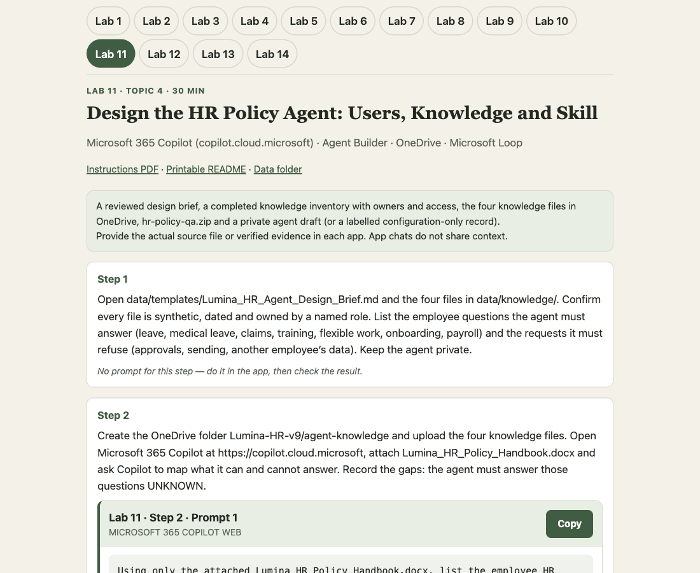

# Microsoft 365 Copilot Lab Prompts

Learner prompt page for TGS-2024043856 *Enhance Work Productivity with Microsoft 365 Copilot*, v9.1 (18 October 2026).

[Open the live prompt page](https://tertiarycourses.github.io/TGS-2024043856-Enhance-Work-Productivity-with-Microsoft-365-Copilot/prompts/)

Fourteen connected Lumina Living HR labs, from cleaning HR case data to a grounded HR Policy Agent. Each lab shows every step first, with its copy-ready prompt directly underneath, plus printable instructions, lab data and the Learner Guide. The page and instructions come from the same verified source.

This deployment branch contains only learner resources. Assessment papers, answer keys, trainer documents, credentials and build tooling are excluded.

Powered by Tertiary Infotech Academy Pte Ltd.
