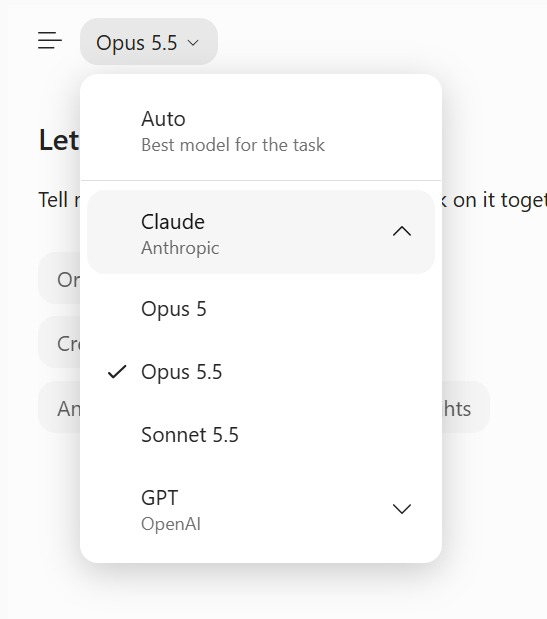
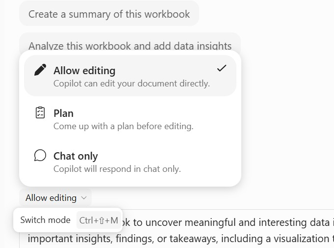
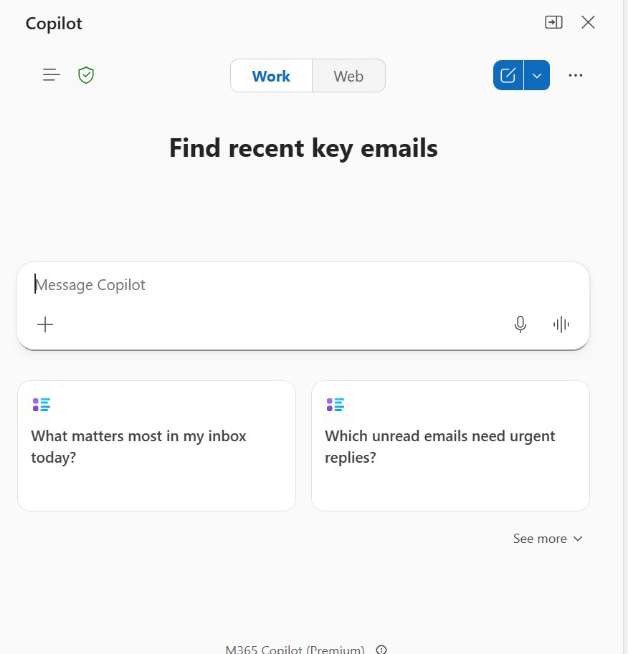

# Lab 2: Create the Cross-App HR Service Update

**Topic 1 · 30 minutes · v9.4 · 20 October 2026**

Continue the verified HR service brief from Lab 1. You will turn it into an initial PowerPoint update, then prepare an Outlook reply to a synthetic HR service thread. You will test how grounding differs between an attached file, a chat transcript and a reviewed summary, and reconcile the same facts across all four apps.

**Learning outcome:** LO1: predict and mitigate integration challenges through verified cross-app grounding and handoffs.

**Expected outcome:** Lumina_Initial_Update.pptx, an unsent Outlook draft and Lumina_Cross_App_Evidence.csv with Excel, Word, PowerPoint and Outlook figures reconciled.

## Files

- [Instruction PDF](Lab-02-Instructions.pdf)
- [Copy-ready prompts](https://tertiarycourses.github.io/TGS-2024043856-Enhance-Work-Productivity-with-Microsoft-365-Copilot/prompts/#lab-2)
- `data/Lumina_HR_Cases.xlsx` — synthetic Lumina source
- `data/templates/` — learner starting templates
- `data/checkpoints/` — clearly labelled rejoin evidence
- `data/templates/Integration_Risk_Register.csv` — LO1 controlled checkpoint for three integration risks

## Prerequisites

- Microsoft 365 account with Copilot available in Word, Excel, PowerPoint and Outlook. Availability depends on the assigned licence and tenant settings; confirm access with the trainer before class.
- Desktop Excel on Windows or Mac is recommended; save working copies to your assigned OneDrive course folder with AutoSave on. Do not overwrite the supplied input.
- Download this whole lab folder. All files are synthetic; Lumina-HR-v9 is your own learner output folder.
- Verified Lab 1 workbook and Word brief, or supplied checkpoint and snapshot.

## Screen Guide

The Copilot screens you will use in this lab. The same screenshots and explanations are in the slides and Learner Guide.

**Model picker**



- **Model picker:** Auto chooses per task. Use the approved default and retest after any change (AI Security principle 5).

**Allow editing · Plan · Chat only**



- **Allow editing · Plan · Chat only:** Edit changes the file, Plan proposes steps first, Chat only never edits. Switch with Ctrl+Shift+M.

**Copilot in Outlook — Work or Web**



- **Work / Web:** Work grounds answers in your mail and files; Web uses public content. Keep HR drafting on Work.
- **Message Copilot:** Ask for the update email and name the reviewed brief; + attaches it.
- **Suggested prompts:** Inbox-triage starters help orientation but are never evidence for HR figures.
- **Human control:** Check every figure against the brief and leave the email unsent until approved.


## Steps

### 1. Open your Lab 1 Word brief and cleaned workbook. If needed use this lab’s verified checkpoint and snapshot, clearly recording rejoin. Read data/Lumina_Email_Thread.txt. It asks for a portfolio update, not authorisation to reassign HR officers.

```text
WORD COPILOT:
From this selected verified Lumina Living HR service brief, extract a handoff table with reporting date, filter scope, total, closed, cancelled, backlog, overdue, unassigned backlog and recorded cost. Separate facts, proposed next actions and open decisions. Keep every value traceable to the supplied brief.
```

### 2. Open data/templates/Lumina_HR_Deck_Template.pptx in PowerPoint and save as Lumina_Initial_Update.pptx. For this initial update use four slides by keeping the first four layout slides and deleting the remaining unused template slides. Open Copilot and select your Word brief with Reference a file; if the command is unavailable, paste the reviewed brief into the prompt.

```text
POWERPOINT COPILOT:
Using this verified Lumina Word brief, create a four-slide initial update: scope and portfolio; backlog and overdue work; current assignments and proposed actions; decision required. Use the existing white/navy/blue design. Preserve all verified metrics. Add source/date notes. Do not invent completed work, savings or approved reassignment.
```

### 3. Review all four slides. Check status definitions, units and date, and correct any invented claim. Save a reconciled CSV using data/templates/Evidence_Register.csv: one row per claim and a source link. This is the bridge between app outputs; app chats are not automatically shared.

```text
POWERPOINT COPILOT:
Audit these four Lumina Living slides against the selected verified HR service brief. For each numeric claim give the source, date and scope; flag unsupported employee-impact, entitlement or approval claims. Propose corrections without changing the checked values.
```

### 4. In Outlook create a new training draft addressed to hr.manager@example.invalid with subject DRAFT - Lumina HR service update - review required. Do not send. Paste the synthetic thread into the draft or use it as quoted context; Copilot summarises the supplied text, not a real mailbox thread. Open Copilot > Draft with Copilot; UI names may differ.

```text
OUTLOOK COPILOT:
Draft a concise reply to the synthetic thread quoted below, using the verified Lumina brief and these checked metrics. State the 30 September 2026 scope, backlog/overdue findings, proposed next actions and the decision requested. Explain that assignments are unapproved proposals. Do not claim the attachments have been sent. Keep as a draft.
```

### 5. If your Outlook offers reference attachments, attach the verified Word brief and choose it as context. Otherwise paste the reviewed metrics into the drafting prompt. Replace any placeholder summary with exact checked values; inspect recipients, subject, tone and attachment names. Save only the draft and a local TXT copy of its reviewed body.

### 6. Ask Word Copilot to compare your pasted slide/email summaries with the brief, then perform the same comparison yourself. Add the cross-app prompt log entries manually. Keep all four source links with the reconciliation record; any mismatch must be fixed before the skill labs.

```text
WORD COPILOT:
Compare these pasted PowerPoint and Outlook summaries with this verified Word brief. List inconsistent figures, status definitions, dates, owner claims or approved-action wording. Do not resolve a conflict by guessing. Return a discrepancy table with source and correction needed.
```

### 7. Complete Integration_Risk_Register.csv using the observed Lumina evidence from Labs 1-2. Enter the impact, preventive control, owner and observable rollback or escalation trigger for all three supplied risk rows.

## Verification

- **Four apps:** Excel Checks, Word brief, four-slide update and unsent Outlook draft share the same date and values.
- **Cross-app grounding:** Named file or pasted verified evidence is provided in each app; no assumed shared chat.
- **Draft boundary:** example.invalid recipient; nothing sent and no assignment approved.
- **LO1 checkpoint:** Integration Risk Register has all three rows, fixed date/baseline evidence and no invented cause or approval.

## Expected Outcome

Lumina_Initial_Update.pptx, an unsent Outlook draft and Lumina_Cross_App_Evidence.csv with Excel, Word, PowerPoint and Outlook figures reconciled.

## Checkpoint

If you fell behind, use data/checkpoints/Lumina_Verified_Checkpoint.xlsx and data/checkpoints/Lumina_Verified_Snapshot.docx. Record checkpoint used in Prompt_Log; then perform this lab, rather than claiming the checkpoint as your output.

## Troubleshooting

| If this happens | Fix |
|---|---|
| Copilot cannot find the source | Use the app file picker to select the actual OneDrive file. A typed local path or a different app chat is not shared context. If needed copy only the verified snapshot into the current app. |
| A total disagrees with Control | Clear dashboard filters to All, check table extent and duplicate IDs, recalculate, then compare definitions and reporting date. Reconcile before continuing. |
| The named feature is missing | Confirm the correct assigned account, English display language and app version. Use the stated manual practice route; record feature unavailable. This is not evidence that a native skill ran. |

## Challenge

Repeat the task for one different department and explain how the filter scope changes the result. Keep the original verified output.

## Reflection

Which evidence proves the output is correct, and which decision still needs a person?

> Lumina Living Pte Ltd and all of its employees, HR cases and HR policies are fictional. Use the verified 120-case baseline and fixed reporting date 30 September 2026. Current case owners are evidence; proposals are not approved. The HR agent answers from approved knowledge only and never approves requests, sends messages or reveals another employee’s data.
