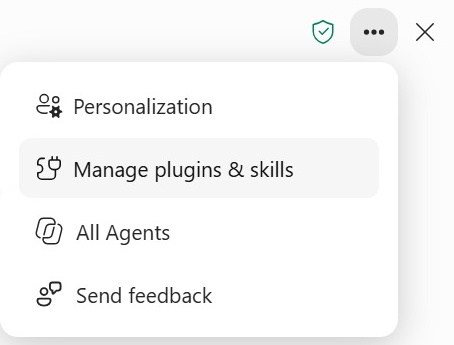
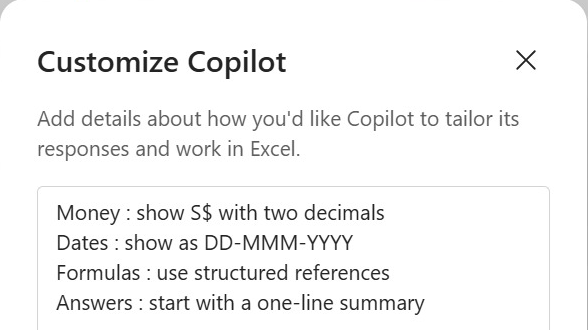

# Lab 3: Personalise Copilot in Excel for Consistent HR Service Reports

**Topic 2 · 30 minutes · v9.4 · 20 October 2026**

Configure temporary account-level display and explanation preferences, test them in two copies of the same verified Lumina workbook, and distinguish preferences from workbook-specific definitions. A task-specific prompt can supersede Personalisation. Restore your previous settings after the exercise.

**Learning outcome:** LO2: plan a controlled transition using Personalisation, .Rules and reusable Skills.

**Expected outcome:** Lumina_Personalisation_Test.xlsx, a two-workbook preference comparison and a private note confirming settings restored.

## Files

- [Instruction PDF](Lab-03-Instructions.pdf)
- [Copy-ready prompts](https://tertiarycourses.github.io/TGS-2024043856-Enhance-Work-Productivity-with-Microsoft-365-Copilot/prompts/#lab-3)
- `data/Lumina_HR_Cases.xlsx` — synthetic Lumina source
- `data/templates/` — learner starting templates
- `data/checkpoints/` — clearly labelled rejoin evidence

## Prerequisites

- Microsoft 365 account with Copilot available in Word, Excel, PowerPoint and Outlook. Availability depends on the assigned licence and tenant settings; confirm access with the trainer before class.
- Desktop Excel on Windows or Mac is recommended; save working copies to your assigned OneDrive course folder with AutoSave on. Do not overwrite the supplied input.
- Download this whole lab folder. All files are synthetic; Lumina-HR-v9 is your own learner output folder.

## Screen Guide

The Copilot screens you will use in this lab. The same screenshots and explanations are in the slides and Learner Guide.

**Open ••• > Personalization**



- **Open ••• > Personalization:** Personalization is the first item. The same menu opens Manage plugins & skills (Labs 5–7) and All Agents (Topic 4).

**Customize Copilot**



- **Customize Copilot:** Enter the four Lab 3 lines (S$ two decimals, DD-MMM-YYYY, structured references, one-line summary), then Save.


## Steps

### 1. Open this lab’s clean data/Lumina_HR_Cases.xlsx and save working copies as Lumina_Personalisation_Test.xlsx and Lumina_Preferences_Copy.xlsx in your Lumina-HR-v9 output folder. Confirm 120 unique IDs, reporting date 2026-09-30 and cost S$35,827.50. Neither copy needs a .Rules sheet or an installed Skill for this test.

```text
EXCEL - CHAT ONLY:
Inspect tblHRCases and Control for Lumina Living. State the clean row count, reporting date and recorded cost. Explain why display preferences should not change source values or reporting definitions. Do not edit.
```

### 2. In Copilot select Settings (...) > Personalization. Keep your existing settings in a private local note, then temporarily use the four lines in data/Personalisation_Preferences.txt: S$ two decimals, DD-MMM-YYYY, structured references and short explanations. Select Save. Preferences apply to your account on subsequent prompts; they are not stored in or shared with the workbook.

### 3. In the first working copy request a small output using your saved preferences. Review the plan before allowing editing. Confirm the date displays 30-Sep-2026 in both copies. Inspect the formulas and number formats in the new Preference_Check sheet; do not accept rounded or rewritten source values.

```text
EXCEL - PLAN:
Plan a Preference_Check sheet showing Control!B2 reporting date, total HR cases and recorded Cost_SGD from tblHRCases for Lumina Living. Use my saved display and explanation preferences. Preserve HR_Cases, IDs, owners and exact values.

EXCEL - ALLOW EDITING:
Apply the reviewed Preference_Check plan with structured-reference formulas. Show a short explanation first and leave the source unchanged.
```

### 4. Open the second copy using the same signed-in account and a new Copilot chat. Do not repeat the preference text in this request. Compare both output displays and formula references; record actual behaviour in data/templates/Customisation_Test_Log.csv. A missed preference is a finding to clarify, not proof of a guaranteed rule.

```text
EXCEL - ALLOW EDITING:
In this second Lumina workbook, create Preference_Check with formula-backed Control!B2 reporting date, total HR cases and recorded Cost_SGD. Follow my saved preferences, preserve source records and explain the result briefly.
```

### 5. Return to the first workbook. Test a specific task instruction that changes only the result display to four decimal places. Verify S$35,827.5000 displays while the numeric value remains 35827.5. Record the comparison; do not alter the saved account settings or source.

```text
EXCEL - ALLOW EDITING:
For this task only, display the recorded cost result in Preference_Check with four decimal places. Keep its formula and exact numeric value unchanged. Do not modify source cells or my saved preferences.
```

### 6. Explain the scope distinction, log the prompts and your observed checks, then return to Settings (...) > Personalization, restore your previous preferences and Save. Keep the restoration note private; do not upload personal account settings to the shared course folder.

```text
EXCEL - CHAT ONLY:
Explain which choices in this exercise belong to my account, which belong to this Lumina workbook and which apply only to one prompt. Use the results I actually observed. Do not claim my preferences are shared with another person or added to the workbook.
```

## Verification

- **Source controls:** Both copies retain120 unique IDs, original owners/statuses and exact cost 35827.50.
- **Display check:** Saved S$ two-decimal/date/explanation preferences are checked in two workbooks; observed misses are recorded.
- **Specific request:** The output can show35,827.5000 without changing its value or the saved preferences.
- **Restoration:** Previous account preferences restored; private baseline note stays outside public courseware.

## Expected Outcome

Lumina_Personalisation_Test.xlsx, a two-workbook preference comparison and a private note confirming settings restored.

## Checkpoint

If you fell behind, use data/checkpoints/Lumina_Verified_Checkpoint.xlsx and data/checkpoints/Lumina_Verified_Snapshot.docx. Record checkpoint used in Prompt_Log; then perform this lab, rather than claiming the checkpoint as your output.

## Troubleshooting

| If this happens | Fix |
|---|---|
| Copilot cannot find the source | Use the app file picker to select the actual OneDrive file. A typed local path or a different app chat is not shared context. If needed copy only the verified snapshot into the current app. |
| A total disagrees with Control | Clear dashboard filters to All, check table extent and duplicate IDs, recalculate, then compare definitions and reporting date. Reconcile before continuing. |
| The named feature is missing | Confirm the correct assigned account, English display language and app version. Use the stated manual practice route; record feature unavailable. This is not evidence that a native skill ran. |

## Challenge

Repeat the task for one different department and explain how the filter scope changes the result. Keep the original verified output.

## Reflection

Which evidence proves the output is correct, and which decision still needs a person?

> Lumina Living Pte Ltd and all of its employees, HR cases and HR policies are fictional. Use the verified 120-case baseline and fixed reporting date 30 September 2026. Current case owners are evidence; proposals are not approved. The HR agent answers from approved knowledge only and never approves requests, sends messages or reveals another employee’s data.
