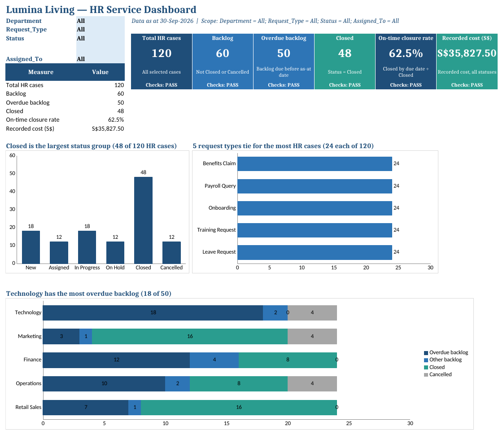

# Lab 7: Create and Apply a Custom Interactive Dashboard Skill

**Topic 3 · 30 minutes · v9.4 · 20 October 2026**

Create hr-case-dashboard/SKILL.md for the Lumina HR service workflow, install it in Excel, then invoke it to plan and build an interactive dashboard. Six KPIs and three charts share four filter selections. Workbook .Rules supplies scope, display and review constraints; the Skill supplies the repeatable method.

**Learning outcome:** LO3: evaluate opportunities in using Microsoft Copilot through a verified dashboard-to-presentation workflow.

**Expected outcome:** Lumina_Dashboard.xlsx with a Dashboard layout, six verified measures, three labelled charts and a measure dictionary ready for Lab 8 filters.

## Files

- [Instruction PDF](Lab-07-Instructions.pdf)
- [Copy-ready prompts](https://tertiarycourses.github.io/TGS-2024043856-Enhance-Work-Productivity-with-Microsoft-365-Copilot/prompts/#lab-7)
- `data/Lumina_HR_Cases.xlsx` — synthetic Lumina source
- `data/templates/` — learner starting templates
- `data/checkpoints/` — clearly labelled rejoin evidence
- `data/templates/hr-case-dashboard/SKILL.md` — Reviewed interactive dashboard Skill fallback

## Prerequisites

- Microsoft 365 account with Copilot available in Word, Excel, PowerPoint and Outlook. Availability depends on the assigned licence and tenant settings; confirm access with the trainer before class.
- Desktop Excel on Windows or Mac is recommended; save working copies to your assigned OneDrive course folder with AutoSave on. Do not overwrite the supplied input.
- Download this whole lab folder. All files are synthetic; Lumina-HR-v9 is your own learner output folder.
- Verified clean table from earlier labs or supplied clean checkpoint.

## Screen Guide

The Copilot screens you will use in this lab. The same screenshots and explanations are in the slides and Learner Guide.

**What Is an Interactive Dashboard?**



- **Filters (B2:B5):** Department, Request_Type, Status and Assigned_To. All includes everything; choices combine with AND.
- **Scope line:** States the as-at date and the active filters, so every reader knows what is shown.
- **KPI tiles:** Six measures from the same selected rows; Checks: PASS confirms chart totals match.
- **Finding titles:** Each chart title is a formula that states the result, e.g. which department has most overdue cases.
- **Linked charts:** Status, request type and department charts all read the same filtered rows.


## Steps

### 1. Open the synthetic source and data/templates/hr-case-dashboard/SKILL.md. In Microsoft 365 Copilot on the web draft the full reusable Skill from this specification. Save it inside a matching hr-case-dashboard folder and review every guard/measure before installation. Log the web prompt manually.

```text
MICROSOFT 365 COPILOT WEB:
Write complete hr-case-dashboard SKILL.md with YAML name/description. Require actual tblHRCases and report date in Control!B2; read visible .Rules. Preserve source IDs/statuses/owners, HR_Officers, Control, .Rules, Prompt_Log, Pareto_* and unrelated sheets. Plan first and ask before replacing only named dashboard outputs; rerun without duplicated charts. Dashboard B2:B5 select Department, Request_Type, Status, Assigned_To with All bypasses and AND logic. B7 total, B8 backlog excluding Closed/Cancelled, B9 backlog Due_Date before Control!B2, B10 Closed, B11 on-time Closed_Date<=Due_Date among Closed only with N/A if none, B12 recorded Cost_SGD across selected statuses. Create three formula-backed editable status/category/department charts sharing the exact filter scope. Use structured references, not fixed120-row ranges, and white/navy/blue/teal workbook design. Baseline check at 2026-09-30 All:120 total,48 Closed,12 Cancelled,60 backlog,50 overdue,30/48 on-time,35827.50 cost. Verify department/no-Closed/no-row tests, source preservation and a separate two-row append sandbox with 122 total,49 Closed,61 backlog,51 overdue,31/49 on-time and 36227.50 cost. These are snapshot tests, not universal future figures. Ask for missing inputs; never approve assignments, infer causes/savings or send email. Return the entire file.
```

### 2. Use Excel Settings (...) > Manage plugins & skills > Custom skills > Open skills folder (Create OneDrive folder if needed). Copy the reviewed hr-case-dashboard folder into that app-created location, Refresh, enable and verify its exact name in Choose plugins & skills. If unavailable, paste the entire reviewed Skill before each prompt, remove @hr-case-dashboard and record Manual practice - native Skill unavailable. Installing hr-case-reporting or hr-case-pareto does not install this distinct Skill.

### 3. Open data/templates/Lumina_Dashboard_Starter.xlsx and save as Lumina_Dashboard.xlsx in OneDrive. If continuing your own workbook, copy its CLEAN tblHRCases into the starter, keeping exact headers and table name; do not create a second table. The starter has a labelled blank Dashboard and four selection cells B2:B5, initially All.

```text
EXCEL - CHAT ONLY:
@hr-case-dashboard Inspect this Lumina Living dashboard starter. Confirm tblHRCases, 120 unique IDs, reporting date 2026-09-30 and selection cells B2:B5 initially All. Explain which source and control sheets must remain intact. Report discrepancies before any edits.
```

### 4. Read Control and confirm the fixed reporting date. Ask for a visual plan before edits. Keep source, Checks and Prompt_Log separate from the Dashboard view. A dashboard is a decision interface: each visual should answer an HR service question rather than decorate the page.

```text
EXCEL - PLAN:
@hr-case-dashboard Plan Dashboard for Lumina HR service at 2026-09-30. Use selection cells B2:B5 for Department, Request_Type, Status, Assigned_To, all initially All. Reserve B7 total cases, B8 backlog, B9 overdue backlog, B10 closed, B11 on-time closure rate, B12 Cost_SGD. Place three charts for status, category and department with labels, units and scope. Preserve source data.
```

### 5. Ask Copilot to insert formulas for the six measures using structured table references. For now all selectors are All; in Lab 8 the same formulas must honour the four filters. Verify the denominator and use N/A, not 0%, if no Closed rows remain.

```text
EXCEL - ALLOW EDITING:
@hr-case-dashboard Build the planned six KPI formulas from tblHRCases. Backlog excludes Closed/Cancelled. Overdue also requires Due_Date < Control!B2. On-time rate counts Closed_Date <= Due_Date among Closed rows only, and shows N/A when none. Recorded cost sums Cost_SGD of all included statuses. Link to table columns, never a fixed 120-row range. Keep source data unchanged.
```

### 6. Add formula-backed chart summaries for the six statuses, five categories and five departments. Use bar/column charts: category and department are nominal groups; a line chart would imply an order that is not present. Label count axes and avoid 3-D effects. Ask the skill for consistent style if available.

```text
EXCEL - ALLOW EDITING:
@hr-case-dashboard Create three editable bar or column charts using formula-backed summaries: HR-case count by Status, by Request_Type and by Department. Each summary must reconcile to the total selected cases. Use white background, navy titles, blue/teal accents, readable labels and a visible reporting date. Do not use category counts as evidence of causes or use colour alone for status.
```

### 7. In Checks confirm sum of each chart’s categories equals 120 with All filters. Compare six KPIs to Control and record the on-time numerator/denominator. Add data/templates/Evidence_Register.csv entries for each chart and metric. If Copilot has used hard-coded numbers, replace them with formulas before Lab 8.

```text
EXCEL - CHAT ONLY:
@hr-case-dashboard Reconcile the Lumina Living dashboard with Control at All selections. Compare all six KPIs and totals of the Status, Request_Type and Department charts. Flag hard-coded values, fixed row ranges, inconsistent scopes and any interpretation that treats request-type frequency as a cause. Do not edit.
```

### 8. Create a measure dictionary on a new Measures sheet: metric, business definition, formula, source fields, date rule, scope and limitation. Ask Copilot to explain formulas, then read one overdue example and one closed example from the source table yourself. Save the baseline dashboard with all filters All.

```text
EXCEL - CHAT ONLY:
@hr-case-dashboard Explain each Dashboard measure in plain English, including terminal statuses, strict overdue date rule, closed-only SLA denominator and meaning of recorded cost. Give one source-row example for overdue and one for on-time closure; cite Case_ID. Do not guess a root cause or financial saving.
```

## Verification

- **Baseline:** Total 120; backlog 60; overdue 50; closed 48.
- **SLA and cost:** 30/48 = 62.5%; S$35,827.50.
- **Chart reconciliation:** Three count summaries each total 120; formulas reference tblHRCases.
- **Decision design:** Measures dictionary and source/date visible; no unsupported cause claims.

## Expected Outcome

Lumina_Dashboard.xlsx with a Dashboard layout, six verified measures, three labelled charts and a measure dictionary ready for Lab 8 filters.

## Checkpoint

If you fell behind, use data/checkpoints/Lumina_Verified_Checkpoint.xlsx and data/checkpoints/Lumina_Verified_Snapshot.docx. Record checkpoint used in Prompt_Log; then perform this lab, rather than claiming the checkpoint as your output.

## Troubleshooting

| If this happens | Fix |
|---|---|
| Copilot cannot find the source | Use the app file picker to select the actual OneDrive file. A typed local path or a different app chat is not shared context. If needed copy only the verified snapshot into the current app. |
| A total disagrees with Control | Clear dashboard filters to All, check table extent and duplicate IDs, recalculate, then compare definitions and reporting date. Reconcile before continuing. |
| The named feature is missing | Confirm the correct assigned account, English display language and app version. Use the stated manual practice route; record feature unavailable. This is not evidence that a native skill ran. |

## Challenge

Repeat the task for one different department and explain how the filter scope changes the result. Keep the original verified output.

## Reflection

Which evidence proves the output is correct, and which decision still needs a person?

> Lumina Living Pte Ltd and all of its employees, HR cases and HR policies are fictional. Use the verified 120-case baseline and fixed reporting date 30 September 2026. Current case owners are evidence; proposals are not approved. The HR agent answers from approved knowledge only and never approves requests, sends messages or reveals another employee’s data.
