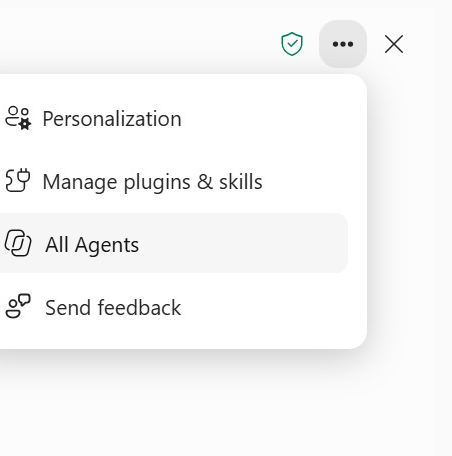
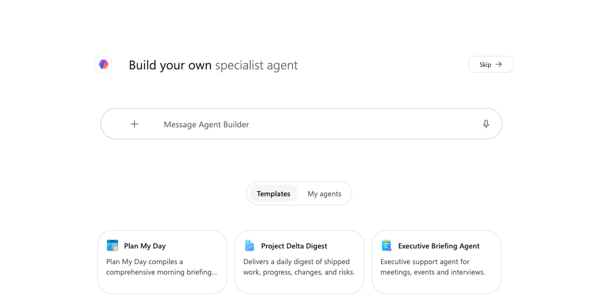
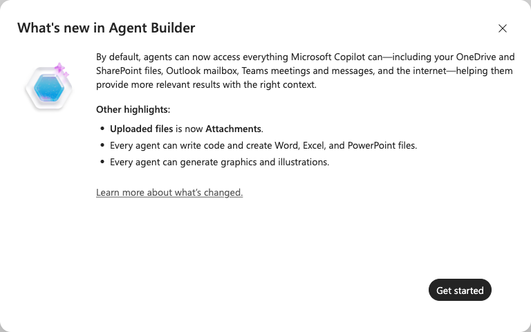

# Lab 11: Design the HR Policy Agent: Users, Knowledge and Skill

**Topic 4 · 30 minutes · v9.3 · 20 October 2026**

Design Lumina HR Policy Agent, an HR helpdesk agent that answers employees’ HR questions from approved knowledge. Decide who it serves and which questions it must answer, inventory and check the HR Policy Handbook and case snapshot it will use, review the hr-policy-qa Skill that shapes every answer, and draft the agent in Agent Builder. The agent explains policy; it never approves, sends or changes records.

**Learning outcome:** LO4: design a staff training plan while configuring, testing and sharing a grounded Microsoft 365 HR agent.

**Expected outcome:** A reviewed design brief, a completed knowledge inventory with owners and access, the four knowledge files in OneDrive, hr-policy-qa.zip and a private agent draft (or a labelled configuration-only record).

## Files

- [Instruction PDF](Lab-11-Instructions.pdf)
- [Copy-ready prompts](https://tertiarycourses.github.io/TGS-2024043856-Enhance-Work-Productivity-with-Microsoft-365-Copilot/prompts/#lab-11)
- `data/Lumina_HR_Cases.xlsx` — synthetic Lumina source
- `data/templates/` — learner starting templates
- `data/checkpoints/` — clearly labelled rejoin evidence
- `data/templates/Lumina_HR_Agent_Design_Brief.md` — Agent design brief
- `data/templates/hr-policy-qa/SKILL.md` — hr-policy-qa Skill for the agent (compress the folder to .zip before upload)
- `data/templates/Lumina_HR_Agent_Test_Matrix.csv` — Eight-case test matrix
- `data/knowledge/` — four approved knowledge items plus the knowledge inventory and owner/configuration register

## Prerequisites

- Microsoft 365 account with Copilot available in Word, Excel, PowerPoint and Outlook. Availability depends on the assigned licence and tenant settings; confirm access with the trainer before class.
- Desktop Excel on Windows or Mac is recommended; save working copies to your assigned OneDrive course folder with AutoSave on. Do not overwrite the supplied input.
- Download this whole lab folder. All files are synthetic; Lumina-HR-v9 is your own learner output folder.
- Microsoft 365 Copilot licence with Agent Builder enabled by your administrator. Skills in agents are a preview for Frontier-enrolled tenants; otherwise use the labelled manual route. Use the supplied configuration-and-test route when Agent Builder is unavailable.

## Screen Guide

The Copilot screens you will use in this lab. The same screenshots and explanations are in the slides and Learner Guide.

**Find Your Agents — ••• > All Agents**



- **Personalization:** Account-level preferences from Lab 3; they apply to you, not to the agent.
- **Manage plugins & skills:** Skills from Labs 5–7; an agent carries its own Skills, such as hr-policy-qa.
- **All Agents:** Lists agents available to you, including the Lumina HR Policy Agent once shared.
- **Send feedback:** Report a wrong or unsafe answer, and also log it in your agent test matrix.

**Agents > New Agent Opens Agent Builder**



- **Describe it:** Tell Agent Builder in plain language what the agent should do; it drafts a configuration for you to review.
- **Skip:** Goes straight to the Configure form; Lab 12 fills it from the reviewed HR agent specification.
- **Templates / My agents:** Start from a template or reopen an agent you built; My agents lists your own.
- **+ sources:** Attach the approved knowledge files while you describe the agent.

**Default Access Is Broad — Narrow It on Purpose**



- **Everything by default:** New agents can reach OneDrive, SharePoint, your mailbox, Teams and the web, the same as Copilot.
- **Why it matters:** An HR policy agent must answer only from the approved handbook (AI Security principle 2: permission control).
- **What you do:** In Lab 12, add the handbook as knowledge and switch off the broad sources before testing.


## Steps

### 1. Open data/templates/Lumina_HR_Agent_Design_Brief.md and the four files in data/knowledge/. Confirm every file is synthetic, dated and owned by a named role. List the employee questions the agent must answer (leave, medical leave, claims, training, flexible work, onboarding, payroll) and the requests it must refuse (approvals, sending, another employee’s data). Keep the agent private.

### 2. Create the OneDrive folder Lumina-HR-v9/agent-knowledge and upload the four knowledge files. Open Microsoft 365 Copilot at https://copilot.cloud.microsoft, attach Lumina_HR_Policy_Handbook.docx and ask Copilot to map what it can and cannot answer. Record the gaps: the agent must answer those questions UNKNOWN.

```text
MICROSOFT 365 COPILOT WEB:
Using only the attached Lumina_HR_Policy_Handbook.docx, list the employee HR questions it answers, with the section number for each. Then list common HR questions it does not answer, which an HR agent must treat as UNKNOWN. Do not invent policy, amounts or approvers.
```

### 3. Complete data/knowledge/Lumina_Knowledge_Inventory.csv: for each file record owner, as-at date, type, purpose and whether a representative employee already has access. Never widen permissions to make a source available. HR_Confidential_Case_Notes.docx is restricted and must not be added as knowledge.

### 4. Read data/templates/hr-policy-qa/SKILL.md. Check its answer format, citation rule, UNKNOWN behaviour, privacy and approval boundaries against the handbook. Compress the hr-policy-qa folder into hr-policy-qa.zip (Mac: right-click > Compress; Windows: right-click > Send to > Compressed (zipped) folder). Upload the .zip, not SKILL.md on its own.

### 5. In Microsoft 365 Copilot select Agents (or Agents & Skills) > New agent. Agent Builder opens with Describe on the left and Configure on the right. Send the prompt below and review every field it fills in. If Agent Builder is unavailable, complete the configuration record and label it Feature unavailable; do not claim creation.

```text
AGENT BUILDER - DESCRIBE:
Create a private agent called Lumina HR Policy Agent for employees of Lumina Living, a fictional company. It answers HR questions about annual and medical leave, claims, benefits, training, flexible work, onboarding and payroll using only the HR Policy Handbook, and gives HR case figures from the verified 30 September 2026 snapshot. Cite the handbook section in every answer and say UNKNOWN when the files do not contain the answer. Never approve requests, send messages, change records or reveal another employee’s personal data.
```

### 6. Compare the drafted name, description and instructions with the design brief. Record the reviewed configuration in data/knowledge/Lumina_HR_Agent_Owner_Config_Register.csv. Save the private draft (or paper configuration), record its actual state and carry it to Lab 12.

## Verification

- **Scope:** One HR helpdesk outcome: cited policy answers and case figures; no approvals, sends or record changes.
- **Knowledge:** Four files with owner, date, type and verified user access; restricted notes excluded.
- **Skill:** hr-policy-qa reviewed against the handbook and compressed to hr-policy-qa.zip.
- **State:** Private draft or accurately labelled configuration-only route.

## Expected Outcome

A reviewed design brief, a completed knowledge inventory with owners and access, the four knowledge files in OneDrive, hr-policy-qa.zip and a private agent draft (or a labelled configuration-only record).

## Checkpoint

If you fell behind, use data/checkpoints/Lumina_Verified_Checkpoint.xlsx and data/checkpoints/Lumina_Verified_Snapshot.docx. Record checkpoint used in Prompt_Log; then perform this lab, rather than claiming the checkpoint as your output.

## Troubleshooting

| If this happens | Fix |
|---|---|
| Copilot cannot find the source | Use the app file picker to select the actual OneDrive file. A typed local path or a different app chat is not shared context. If needed copy only the verified snapshot into the current app. |
| A total disagrees with Control | Clear dashboard filters to All, check table extent and duplicate IDs, recalculate, then compare definitions and reporting date. Reconcile before continuing. |
| The named feature is missing | Confirm the correct assigned account, English display language and app version. Use the stated manual practice route; record feature unavailable. This is not evidence that a native skill ran. |

## Challenge

Write one new employee HR question the handbook does not answer, run it and explain which instruction, Skill rule or knowledge boundary controlled the response.

## Reflection

Which evidence proves the output is correct, and which decision still needs a person?

> Lumina Living Pte Ltd and all of its employees, HR cases and HR policies are fictional. Use the verified 120-case baseline and fixed reporting date 30 September 2026. Current case owners are evidence; proposals are not approved. The HR agent answers from approved knowledge only and never approves requests, sends messages or reveals another employee’s data.
